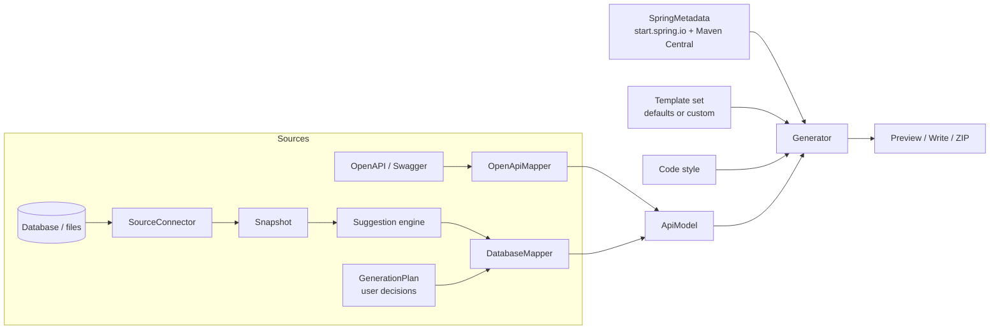
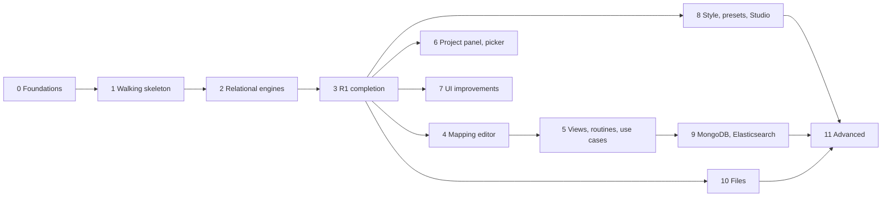

# SpecForge phase 2: Database-first generation, Spring Boot sync and Studio

| | |
|---|---|
| **Status** | Ready for implementation, pending the open questions in [§19](#19-open-questions) |
| **Audience** | The engineer (or AI coding agent) implementing this phase; the product owner reviews each milestone |
| **Last updated** | 2026-10-17 |
| **Reference implementation** | `D:\Workspace\projects\FullStack\querywise-source` (Python, same connector problem, proven on every engine) |
| **Prior art** | `D:\Workspace\workspace\Java\reverse_engineering` (the owner's Hibernate Tools generator: house style to keep, defects to avoid) |
| **Conventions** | **MUST**, **SHOULD**, **MAY** as in RFC 2119. Every requirement has an ID (e.g. `CONN-3`) and a release tag (**R1**, **R2**, **R3**, see [§7](#7-releases-and-scope)). Milestones, tests and reports refer to requirements by ID. |

---

## Contents

0. [How to work on this phase](#0-how-to-work-on-this-phase)
1. [Summary](#1-summary)
2. [Goals, non-goals and success criteria](#2-goals-non-goals-and-success-criteria)
3. [Product principles](#3-product-principles)
4. [Context](#4-context)
5. [Architecture](#5-architecture)
6. [Decisions](#6-decisions)
7. [Releases and scope](#7-releases-and-scope)
8. [Libraries: reuse before building](#8-libraries-reuse-before-building)
9. [Requirements: Spring Boot sync and project setup](#9-spring-boot-sync-and-project-setup)
10. [Requirements: user interface](#10-user-interface)
11. [Requirements: Code style and Spring Boot Studio](#11-code-style-and-spring-boot-studio)
12. [Requirements: connection, drivers and credentials](#12-connection-drivers-and-credentials)
13. [Requirements: introspection](#13-introspection)
14. [Requirements: selection, mapping and operations](#14-selection-mapping-and-operations)
15. [Requirements: generated project and generation plan](#15-generated-project-and-generation-plan)
16. [Non-functional requirements and security](#16-non-functional-requirements-and-security)
17. [Engineering workflow](#17-engineering-workflow)
18. [Testing strategy](#18-testing-strategy)
19. [Open questions](#19-open-questions)
20. [Milestones](#20-milestones)
21. [Risks](#21-risks)
- [Appendix A: Verified facts (2026-10-17)](#appendix-a-verified-facts-2026-10-17)
- [Appendix B: Engine catalog](#appendix-b-engine-catalog)
- [Appendix C: API surface and error codes](#appendix-c-api-surface-and-error-codes)
- [Appendix D: Glossary](#appendix-d-glossary)

---

## 0. How to work on this phase

1. **Read before writing code:** this whole document; the reference implementation
   ([§4.2](#42-reference-implementation-querywise)); the prior art
   ([§4.3](#43-prior-art-the-product-owners-hibernate-tools-generator)); the SpecForge files
   ([§4.1](#41-specforge-today)).
2. **Resolve the open questions** ([§19](#19-open-questions)) with the product owner before milestone 0. Where
   an answer is missing, apply the suggested answer and say so in your report.
3. **Ship the thinnest working slice first.** Milestone 1 is a walking skeleton (PostgreSQL → working CRUD
   app). Breadth comes after the path works end to end ([§7](#7-releases-and-scope), [D12](#6-decisions)).
4. **One milestone at a time** ([§20](#20-milestones)), inside its scope. Parallel workstreams start only
   where [§20.2](#202-workstreams-and-dependencies) allows.
5. **Contracts before code.** The snapshot and plan formats ([§5.4](#54-contracts)) are written as JSON Schemas
   and reviewed before the code that produces or consumes them.
6. **Design note first** for a new package, interface or on-disk format: at most one page in `docs/design/`.
7. **Deviations are recorded** as an ADR in `docs/adr/NNN-title.md` (context, decision, consequences) and
   flagged in the milestone report.
8. **New dependencies are declared** in the milestone report (version, license) and in `THIRD-PARTY-NOTICES`.
   Check the license when adding, even for libraries suggested in [§8](#8-libraries-reuse-before-building).
9. **Match the codebase**: naming, comment density and idioms of the surrounding code. The generator is a plain
   Java 17 application (no Spring); keep it that way.
10. **Small changes**: one reviewable change per requirement group, tests in the same change.
11. **Milestone report**, every time:

    ```
    ## Milestone N: <name>
    Built:        what exists now, by requirement ID
    Verified:     exact commands run and their results (tests, builds, generated projects compiled)
    Not done:     what was deferred and why
    Deviations:   ADR links, or "none"
    Dependencies: added libraries with versions and licenses
    Measures:     JAR size, startup time, introspection time where relevant
    Risks seen:   anything the next milestone should know
    ```

## 1. Summary

SpecForge turns a Swagger/OpenAPI spec into a Spring Boot project. This phase makes it a general Spring Boot
project builder:

- **Build from a database**, not only from a spec. The user connects to any database or data file, SpecForge
  reads everything in it, the user chooses what to generate and how, and SpecForge produces a complete project
  with full CRUD, per-operation control and use-case controllers. **Every driver is bundled.**
- **Stay in sync with Spring Boot**: versions and library coordinates come from Spring's published metadata,
  with a project setup and dependency picker that feel like start.spring.io.
- **Users decide how the code looks**: defaults, Code-style choices and presets, or templates customized in the
  **Spring Boot Studio** with a live preview.
- **A better UI** that carries all of this without becoming harder to use.

It is delivered in three releases. **R1** is a usable database-first generator for every relational engine.
**R2** adds full control (mapping editor, use-case controllers, routines, project setup, Studio). **R3** adds the
remaining source types and advanced features.

## 2. Goals, non-goals and success criteria

### 2.1 Goals

| ID | Goal |
|---|---|
| G1 | Generate a compiling, runnable Spring Boot project with full CRUD from any supported source ([§2.3](#23-supported-sources)). |
| G2 | Every generation decision is visible and editable; suggestions are marked as suggestions. |
| G3 | Spring Boot versions and library coordinates are always current, with an offline fallback. |
| G4 | Users can see and change how generated code looks, without leaving SpecForge. |
| G5 | Connecting to a database is safe: read-only, no secret ever leaked, honest per-engine guarantees. |
| G6 | Value reaches users early: a working relational database-first flow (R1) before breadth and polish. |

### 2.2 Non-goals for this phase

- Combining a spec and a database in one project (mapping spec endpoints onto tables). The internal model stays
  shared so it is possible later; the source picker leaves room for a third "Both" choice.
- Writing to the user's source in any way: no DDL, no data changes.
- Kotlin or Groovy as the generated project's language (the templates are Java).
- A hosted or multi-user SpecForge. It remains a local, single-user application bound to loopback.

### 2.3 Supported sources

| Tier | Sources | Generated persistence | Release |
|---|---|---|---|
| 1. Relational | PostgreSQL, MySQL, MariaDB, Microsoft SQL Server, Oracle, IBM Db2 LUW, SQLite, H2 | Spring Data JPA | R1 |
| 2. Document & search | MongoDB, Elasticsearch | Spring Data MongoDB / Spring Data Elasticsearch | R3 |
| 3. Files | CSV, Excel (`.xlsx`/`.xlsm`), Parquet | A tier-1 database chosen by the user; optional data import | R3 |
| 4. Generic JDBC | Any other JDBC database (Snowflake, ClickHouse, Redshift, …) | JPA with a generic dialect, best effort | R3 |

### 2.4 Success criteria

| ID | Criterion | Measured by | Release |
|---|---|---|---|
| S1 | For every engine of the release's tiers, a project generated from the reference fixture compiles, starts against that engine, and passes generated CRUD calls. | Live test suite ([§18](#18-testing-strategy)) | R1 (tier 1), R3 (tiers 2–4) |
| S2 | Generated projects compile on the latest patch of every supported Boot line, for every sample spec and mode. | Boot matrix test | R1 |
| S3 | No secret appears in any API response, log line, profile, plan or generated file. | Secret-leak test per engine | R1 |
| S4 | Introspecting a 2,000-table schema completes in under 60 s on a local container, and the UI stays responsive. | Performance test | R1 |
| S5 | The spec-first flow has no unintended output change. | Golden-file tests | R1 |
| S6 | Every step of both flows is keyboard-operable and passes automated accessibility checks. | Browser tests with axe-core | R2 (new screens from R1) |
| S7 | From connecting to a running generated app takes under 5 minutes for a first-time user on the sample database. | Moderated walkthrough at each release | R1 |

## 3. Product principles

Non-negotiable. When a requirement seems to conflict with one, the principle wins; raise it in the report.

| ID | Principle |
|---|---|
| P1 | **The user decides; the system only suggests.** Source type, Boot version, names, relations, operations, controller grouping, code style: all editable. Suggestions are visibly marked. No hidden heuristic the user cannot override. |
| P2 | **Opt-in, no unintended change.** Existing output changes only deliberately: golden files are updated in the same change, with a changelog entry. Profiles that pin a Boot version keep producing the same output for that version. |
| P3 | **Everything by default, then clean up.** The default plan is one controller per selected table with full CRUD; the user removes, merges and renames from there. |
| P4 | **The source is never modified.** SpecForge reads metadata only. Reading data happens only on explicit opt-in (MongoDB sampling, file import). Generated apps use `ddl-auto=validate` or `none`, never `update`/`create`. |
| P5 | **Reproducible.** Every choice lives in a versioned generation plan; the same plan, source and SpecForge version produce the same project. |
| P6 | **Honest about each engine.** The UI states each engine's real controls and limits. |
| P7 | **Never blocked by the network.** Online metadata improves defaults; SpecForge always works offline from a bundled snapshot. |
| P8 | **Secrets never leak.** Not in responses, logs, profiles, plans, error messages or generated files. |

## 4. Context

### 4.1 SpecForge today

| Area | Files | Relevance |
|---|---|---|
| Generation model | `src/main/java/io/specforge/model/Model.java` (`ApiModel`, `ClassDef`, `FieldDef`, `ResourceModel`, `OperationModel`, `ParamDef`, `TypeRef`, `SecurityDef`) | The database flow maps into this model ([D1](#6-decisions)). |
| Spec mapping | `mapper/OpenApiMapper.java`, `mapper/SecurityMapper.java` | `DatabaseMapper` is the sibling of `OpenApiMapper`. |
| Rendering | `gen/Generator.java`, `gen/TemplateManager.java`, `gen/ProjectWriter.java`, `resources/templates/manifest.json`, `*.ftl` | Reused for preview, write and ZIP. FreeMarker runs sandboxed (`ALLOWS_NOTHING_RESOLVER`), with `[=expr]` interpolation. |
| Build file | `resources/templates/pom.xml.ftl` | Hard-codes Boot 3 starter names; replaced by synced coordinates ([§9](#9-spring-boot-sync-and-project-setup)). |
| Settings | `config/GeneratorConfig.java`, `config/ProfileStore.java` | `options.springBootVersion` is free text, default `3.5.6`; `templatesDir` points to one override folder. |
| Web server | `web/Api.java`, `web/WebServer.java` | Plain JDK HTTP server, JSON under `/api/...`, loopback only, `X-SpecForge` header check. |
| UI | `resources/web/index.html`, `app.js`, `app.css` | Vanilla JS, no build step; three steps; fields bind with `data-path`; follow-up questions with `data-show-when`; light and dark themes via CSS variables. |
| Spec loading | `spec/SpecLoader.java`, `spec/SpecStore.java` | The database snapshot gets the same load-and-cache-by-id treatment. |
| Packaging | `pom.xml` | Shaded fat JAR with `ServicesResourceTransformer` (keeps `META-INF/services/java.sql.Driver` working). |
| Existing modes | Proxy mode (`upstream-client.java.ftl`, forward / service-account auth) and database mode | Must keep working ([§18](#18-testing-strategy)). |
| Tests | None today; `verify.sh` builds, generates petstore and compiles it | This phase adds the test suite ([§18](#18-testing-strategy)). |

### 4.2 Reference implementation: querywise

The product owner solved the same connector problem in Python. **Port its patterns; do not reinvent them.**

| File | Take from it |
|---|---|
| `backend/connectors.py` | The `KINDS` registry (label, dialect, URL or path target, example, plain-language **controls** and **limits**); one connector per family with `test()`, `discover()`, `close()`; clear "missing driver" errors; `redact()`; per-engine read-only `guards()`; MongoDB discovery by sampling; Elasticsearch discovery via `_resolve/index` + `_mapping`; Excel/CSV/Parquet loaded into an in-memory engine, then locked down. |
| `backend/sources.py` | Environment-variable references (`url_env`, `password_env`) overriding stored values; a secret-free sources file; **test before discover**; a failed connection keeps the previous source; schema cache keyed by a connection fingerprint. |
| `backend/state.py` | Secrets encrypted at rest (passphrase env var + PBKDF2 + per-install salt, or a generated owner-only key file); masking; **keyed** (HMAC) fingerprint. |
| `compose.test.yaml`, `scripts/run_live_tests.ps1` | One container per engine, an `-AcceptLicenses` gate, throwaway passwords in the process environment only, no published host ports. |
| `pack/<engine>/` | Multi-engine business schemas (`V001__schema.sql`, `V002__business_flags.sql`, seeds, least-privilege `reader_role.sql`): test fixtures. |
| `sample-databases/` | 40-table PostgreSQL and Oracle schemas: performance fixtures. |
| `tests/test_live_sources.py`, `tests/test_backend.py` | What to test: redaction, env overrides, failed-connection behaviour, SKIP-not-PASS. |

Differences: SpecForge reads **metadata only** (querywise runs queries), and must handle **thousands** of tables
(querywise caps at 200).

### 4.3 Prior art: the product owner's Hibernate Tools generator

`D:\Workspace\workspace\Java\reverse_engineering` is the owner's earlier database-first generator: **Hibernate
Tools 4.3 (`hbm2java`)**, Java 8, `javax.persistence`, a `hibernate.reveng.xml` (type mapping), custom FreeMarker
templates under `src/main/resources/modele/` (entity per database, repository, service interface +
implementation, controller, read-only controller for views), and entities generated from a PostgreSQL
`administration` schema. It shows the **house style the owner wants** and the **failure modes to design out**.

**Keep:**

| Idea in the prior art | Where | Becomes |
|---|---|---|
| Ordered type-mapping rules, precision/scale aware (`NUMERIC(1,0)`, `NUMERIC(23,3)`, …) | `hibernate.reveng.xml` | MAP-6 |
| ID generation differs per database (identity; sequences named by convention, `allocationSize=1`) | `PojoFields{Mysql,Postgres,Oracle}.ftl` | MAP-7 |
| A read-only controller for views (get by id + search) | `controllerView.ftl` | OPS-7 |
| A generic paginated search endpoint (search object in a `POST` body) | `controller.ftl` | OPS-8 |
| Response envelope (`code`, payload); interface + implementation services with an `I` prefix | `classService.ftl`, `interfaceService.ftl` | STYLE-3, STYLE-4 |
| Column-name constants per entity, for dynamic queries | `PojoFieldsStatic.ftl` | STYLE-5 |
| Templates split into reusable parts | `<#include>` in `Pojo*.ftl` | STU-11 |
| Composite keys as `@EmbeddedId`; join tables as `@ManyToMany`; `schema` and unique constraints on `@Table` | generated `UserRoles`, `Roles`, `Users` | MAP-1, MAP-4, MAP-8 |
| Table filters and per-table overrides in one file | `hibernate.reveng.xml` concept | SEL-2, PLAN-1 |

**Avoid (real defects in the prior art's output; each has a regression test in [§18.3](#183-prior-art-regression-fixture)):**

| Defect observed | Cause | Guarded by |
|---|---|---|
| `@Version` on `audit_logs.timestamp` and `notifications.timestamp`: an audit timestamp silently became optimistic locking | Name-based heuristic applied automatically | MAP-2 |
| `error_logs.details` (`jsonb`) mapped to `UUID`, with no import: the class does not compile | JDBC `OTHER` mapped blindly (PostgreSQL reports `uuid`, `jsonb`, `inet`, enums… all as `OTHER`) | MAP-6 |
| Collections named `roleses`, `permissionses`, `notificationses` | Naive pluralization of an already plural name | MAP-10 |
| Every relation bidirectional (`Users` holds five collections) | Generator default | MAP-4 |
| Lombok `@Data` on entities with bidirectional relations | Recursive `toString`/`hashCode`, broken entity equality | STYLE-1, GEN-7 |
| Exceptions turned into `null`/`false`; errors logged with `toString()` | Template pattern | GEN-7 |
| `@CrossOrigin(origins = "*")` on every controller | Template pattern | GEN-7 |
| Template typos (`new new …`) and missing imports (`ICommonService`, `UUID`) shipped | Templates never compiled in CI | STU-13, Boot matrix |
| `java.util.Date` everywhere; `Cloneable`/`clone()` on entities | Java 8-era defaults | MAP-6, GEN-7 |
| Sequence names guessed (`{table}_seq` vs `{table}_{column}_seq`) | No sequence detection | MAP-7 |

## 5. Architecture

### 5.1 Flow



The spec flow is unchanged. The database flow adds a connector, a snapshot, a suggestion engine, a plan and a
mapper; both flows meet at `ApiModel`. The **effective model** is the suggestions computed from the snapshot,
overridden by the user decisions stored in the plan ([PLAN-5](#152-generation-plan)).

### 5.2 Packages (suggested)

| Package | Responsibility |
|---|---|
| `io.specforge.source` | `SourceKind` registry (engines, tiers, controls, limits), `SourceConnector` interface |
| `io.specforge.source.jdbc` | JDBC connector, `Dialect` per engine, driver loading and self-check |
| `io.specforge.source.mongo`, `.elastic`, `.files` | Tier-2 and tier-3 connectors (R3) |
| `io.specforge.snapshot` | Snapshot model and its cache |
| `io.specforge.suggest` | Suggestion engine: type rules, ID detection, naming, relation and pattern detection |
| `io.specforge.plan` | `GenerationPlan`, default plan, plan diff and migration |
| `io.specforge.mapper` | Adds `DatabaseMapper` (snapshot + suggestions + plan → `ApiModel`) |
| `io.specforge.spring` | Metadata client, cache, bundled snapshot, dependency resolution |
| `io.specforge.studio` | Template sets, render-for-preview, variable tree, diffs (R2) |
| `io.specforge.secrets` | `SecretStore` (AES-GCM), `Redactor`, fingerprints |
| `io.specforge.jobs` | Long-running operations with progress and cancel |

### 5.3 Key interfaces (sketch; refine in the design notes)

```java
/** One per engine family. Read-only by construction. */
public interface SourceConnector extends AutoCloseable {
    SourceKind kind();
    ConnectionInfo test();                                   // probe: server version, visible schemas
    Snapshot introspect(IntrospectRequest request, Progress progress, Cancellation cancel);
}

/** Per relational engine: what DatabaseMetaData misses or gets wrong (D13). */
public interface Dialect {
    List<String> readOnlyGuards(GuardSettings settings);    // e.g. SET TRANSACTION READ ONLY
    void readSequences(Connection c, SnapshotBuilder b, Set<String> schemas) throws SQLException;
    void readIdentity(Connection c, SnapshotBuilder b, Set<String> schemas) throws SQLException;
    void readViews(Connection c, SnapshotBuilder b, Set<String> schemas) throws SQLException;     // R2
    void readRoutines(Connection c, SnapshotBuilder b, Set<String> schemas) throws SQLException;  // R2
    void readEnums(Connection c, SnapshotBuilder b, Set<String> schemas) throws SQLException;     // R2
    OptionalLong estimateRows(Connection c, TableRef table) throws SQLException;
}

/** Snapshot → suggestions. Deterministic for a given ruleset version (PLAN-5). */
public interface SuggestionEngine {
    String rulesetVersion();
    Suggestions suggest(Snapshot snapshot, TypeRules rules, NamingSettings naming);
}

/** Snapshot + suggestions + the user's decisions + settings → the model every template understands. */
public final class DatabaseMapper {
    public ApiModel map(Snapshot snapshot, Suggestions suggestions, GenerationPlan plan, GeneratorConfig config) { ... }
}

public interface SpringMetadataSource {
    SpringMetadata current();                                // cached, else bundled snapshot
    SpringMetadata refresh() throws MetadataUnavailable;     // never blocks generation
}
```

### 5.4 Contracts

Both formats are versioned JSON with a JSON Schema in `docs/contracts/` (`snapshot.schema.json`,
`plan.schema.json`), frozen at the end of milestone 1 and changed only through a schema version bump with a
migration.

- **Snapshot:** everything introspected, engine-neutral (schemas, tables, columns with vendor and JDBC types,
  keys, constraints, indexes, sequences, identity, views, routines, row estimates), plus `engine`,
  `serverVersion`, `capturedAt` and warnings. Never contains secrets or row data (except MongoDB field samples'
  *types*, never values).
- **Plan:** **only the user's decisions** (selection and overrides), plus `planVersion`, `specforgeVersion` and
  the suggestion `rulesetVersion` it was made with. Anything the user did not change is recomputed from the
  snapshot, so better suggestions in a later SpecForge release reach the user, shown as a diff ([PLAN-5](#152-generation-plan)).

Example plan (illustrative; the schema is authoritative):

```json
{
  "planVersion": 1,
  "specforgeVersion": "1.1.0",
  "rulesetVersion": "2026.10",
  "source": { "engine": "POSTGRESQL", "connectionId": "c-7f3a", "schemas": ["administration"] },
  "boot": { "version": "4.1.1", "java": "21" },
  "style": { "preset": "specforge-default" },
  "select": { "include": ["administration.*"], "exclude": ["administration.flyway_schema_history"] },
  "entities": {
    "administration.users": {
      "className": "AppUser",
      "operations": { "delete": false },
      "finders": ["email"]
    },
    "administration.audit_logs": {
      "fields": { "details": { "javaType": "com.fasterxml.jackson.databind.JsonNode" } }
    }
  },
  "controllers": [],
  "routines": [],
  "dependencies": { "added": ["actuator"], "declinedSuggestions": ["flyway"] }
}
```

### 5.5 State on disk

Under `~/.specforge/` (overridable with `--home`). Every write is atomic (temp file + move).

| Path | Content | Sensitivity |
|---|---|---|
| `profiles/*.json` | Settings, code style, selected dependencies, generation plans | No secrets, ever |
| `templates/<set>/` | Template sets (`manifest.json`, `*.ftl`, base hashes) | Not sensitive |
| `connections.json` | Saved connections; secret fields encrypted | Encrypted secrets |
| `secret.key` | Generated key when `SPECFORGE_SECRET_KEY` is not set | Owner-only permissions |
| `spring-metadata.json` | Cached Spring metadata with fetch time | Not sensitive |
| `snapshots/` | Cached snapshots, named by fingerprint | Schema metadata: treat as confidential, never shared automatically |
| `drivers/` | Optional extra JDBC driver JARs (R3) | Code: loaded only from here |

## 6. Decisions

| ID | Decision | Rationale | Rejected alternative |
|---|---|---|---|
| D1 | Introspect into a **snapshot**, then map snapshot + suggestions + plan into the **existing `ApiModel`**; extend `ClassDef`/`FieldDef`/`OperationModel` where database facts are missing. | Reuses preview, write, ZIP, templates, profiles, naming, layers and security. | A separate database-only generator: two pipelines to maintain. |
| D2 | **Bundle every driver** in the JAR; also load extra JARs from `~/.specforge/drivers/`. | Product requirement: users never install drivers. | Download drivers on demand: needs network, worse first run. |
| D3 | **Render build files ourselves** from Initializr metadata. | Offline, testable, full control over previews and existing files. | Download `/starter.zip` at generation time. |
| D4 | **The UI stays vanilla HTML/CSS/JS** with vendored single-file libraries (as `highlight.min.js` is today). | No build step, small JAR, same as today. | A framework with an npm build (revisit only with product-owner approval, Q7). |
| D5 | **Saved connections are encrypted locally** (AES-GCM; PBKDF2 key from `SPECFORGE_SECRET_KEY`, else an owner-only key file), with env-var references as an alternative. | Saved connections without plaintext secrets; proven in querywise. | Never saving connections. |
| D6 | **One template set, version-aware** via `bootMajor`, with a declared `bootRange`. | Boot 3 and 4 differences are small and local. | One template set per Boot major: duplication that drifts. |
| D7 | **Testcontainers** for integration and live tests, with the same images as querywise. | Java-native, runs from Maven, per-test lifecycle, local reuse mode. | docker-compose driven from scripts. |
| D8 | **Long operations are jobs** (`POST` starts, `GET` polls progress, `DELETE` cancels). | Uniform progress and cancel; fits the plain JDK server. | Blocking requests: frozen UI on large sources. |
| D9 | **Generation plan = versioned JSON of user decisions only**, stored in profiles. | Reproducible, diffable, migratable; improved suggestions still reach users. | Implicit UI state; or storing every computed value (suggestions frozen forever). |
| D10 | **No Hibernate Tools** for introspection; borrow its concepts (ordered type rules, filters, overrides). | Reads JDBC metadata only, ties SpecForge to a Hibernate version, and its heuristics produced the defects in [§4.3](#43-prior-art-the-product-owners-hibernate-tools-generator). | Wrapping `hibernate-tools` (`RevengStrategy`). |
| D11 | **House styles ship as template-set presets**: "SpecForge default" and "Classic layered" (the owner's prior style), rebuilt from requirements, not copied. | The owner's proven style in one click; other teams add theirs the same way. | One hard-coded style; or copying the old templates. |
| D12 | **Deliver in three releases, walking skeleton first** ([§7](#7-releases-and-scope)): PostgreSQL → working CRUD app before breadth, Studio or UI polish. | Earliest user value; the architecture is proven before it is widened; templates are adjusted later at low cost. | Building every layer fully before the first end-to-end result. |
| D13 | **Relational metadata via `DatabaseMetaData` bulk calls + one `Dialect` per engine** (decided by SPIKE-1, [ADR 001](../adr/001-introspection-engine.md)). | Measured on 2,010 tables: ~0.8 s versus ~31 s for SchemaCrawler, with no added dependency (SchemaCrawler brings a second Jackson line). | SchemaCrawler as the metadata engine. |

## 7. Releases and scope

| Release | Theme | Content (by requirement tag) | Exit |
|---|---|---|---|
| **R1** | Database-first works for every relational engine | Boot 4 compatibility and version select, all tier-1 drivers, safe connections, core introspection, default plan with full CRUD and per-operation toggles, safe mapping defaults, minimal source-choice UI, the prior-art fixture | S1 (tier 1), S2–S5, S7; release checklist ([§17.4](#174-release-checklist)) |
| **R2** | Full control | Mapping editor, views and routines, use-case controllers and clean-up, search styles, project panel and dependency picker, live metadata sync, UI improvements, Code style, presets and Studio core | S6; release checklist |
| **R3** | Every source, advanced features | MongoDB, Elasticsearch, files, generic JDBC, Gradle, plan diff, Studio advanced, optional outputs | S1 (tiers 2–4); release checklist |

In R1 the user sees and accepts the suggested mapping (shown read-only in the plan preview, per entity); editing
it arrives with the mapping editor in R2 (MAP-11). Names, operations and selection are editable from R1.

Every requirement below carries its release in the **Rel** column. A requirement tagged for a later release
MUST NOT be implemented early unless the milestone report justifies it.

## 8. Libraries: reuse before building

Each saves days to weeks. Verify the license and current version when adding (rule 8 in [§0](#0-how-to-work-on-this-phase)).

| Library | Use | License (verify) | Release |
|---|---|---|---|
| ~~SchemaCrawler~~ | Evaluated in SPIKE-1 and rejected ([ADR 001](../adr/001-introspection-engine.md)): 30× slower here, conflicting Jackson dependencies | EPL-2.0 / LGPL-3.0 / GPL-3.0 | n/a |
| Evo Inflector | Singular/plural names (MAP-10) | Apache-2.0 | R1 |
| Testcontainers + database modules | Integration and live tests | MIT | R1 |
| JUnit 5, AssertJ | Tests | EPL-2.0, Apache-2.0 | R1 |
| java-diff-utils | Preview diffs, plan diffs, Studio diffs | Apache-2.0 | R2 |
| JavaParser | Syntax check of rendered Java (STU-5) | Apache-2.0 / LGPL | R2 |
| CodeMirror 5 (vendored) | Studio editor (STU-2) | MIT | R2 |
| Playwright for Java, axe-core | UI and accessibility tests | Apache-2.0, MPL-2.0 | R1 (smoke), R2 (full) |
| Drivers | See [Appendix B](#appendix-b-engine-catalog) | Per driver | R1 (tier 1), R3 |

In generated projects (not SpecForge itself): MapStruct (optional), `hibernate-jpamodelgen` (STYLE-5), springdoc
(optional), Flyway or Liquibase (optional), all with coordinates from the sync.

**SPIKE-1: SchemaCrawler evaluation** (milestone 0, time-boxed to 2 days). **Done: rejected**, see
[ADR 001](../adr/001-introspection-engine.md). It would have passed when all of these held:

1. Reads tables, columns (vendor types), primary, foreign and unique keys, indexes and sequences on PostgreSQL,
   MySQL, MariaDB, SQL Server, Oracle, SQLite and H2 from the fixtures; Db2 at least tables and keys.
2. Introspects 2,000 tables within S4 with bulk retrieval enabled.
3. Runs with a read-only connection and the RO-1 guards.
4. License and dependency footprint are acceptable for bundling (no conflicts with drivers or Jackson).

Outcome recorded as an ADR; D13 then becomes final either way.

## 9. Spring Boot sync and project setup

### 9.1 Metadata sync

| ID | Rel | Requirement |
|---|---|---|
| SYNC-1 | R1 | SpecForge MUST read Boot versions, Java versions and dependency entries from `https://start.spring.io/` (`Accept: application/vnd.initializr.v2.2+json`), and per-version coordinates from `/dependencies?bootVersion=X`. |
| SYNC-2 | R2 | SpecForge MUST read released Boot versions from Maven Central (`spring-boot-dependencies/maven-metadata.xml`), to offer the latest patch of older lines Initializr no longer lists. |
| SYNC-3 | R2 | Metadata MUST be cached in `~/.specforge/spring-metadata.json`, refreshed when older than 24 h and on a manual "Refresh from start.spring.io" action that shows the last-sync time. |
| SYNC-4 | R1 | A metadata snapshot MUST be bundled in the JAR, refreshed by the build (a build step that runs SYNC-1/SYNC-2 and commits the result for review). First run and offline runs use it; a failed sync is a quiet notice, never a blocking error (P7). |
| SYNC-5 | R1 | The sync MUST only issue HTTPS GETs to `start.spring.io` and `repo1.maven.org`, with timeouts, send no user data, and validate responses (schema and size) before use. |

### 9.2 Versions, coordinates and templates

| ID | Rel | Requirement |
|---|---|---|
| VER-1 | R1 | The Spring Boot field MUST be a select: Initializr's GA versions plus the latest patch of each older line in the templates' tested range. Initializr's default is pre-selected and marked as suggested. "Other…" allows free text, with a warning outside the tested range. |
| VER-2 | R1 | The Java field MUST be a select from Initializr's list, limited to versions the chosen Boot line supports (Initializr compatibility data where present, otherwise the documented support matrix). |
| VER-3 | R1 | Generated build files MUST take every starter and driver coordinate from `/dependencies?bootVersion=X` and MUST NOT write a `<version>` for anything the Boot BOM manages. Unmanaged libraries get explicit versions from Maven Central metadata. |
| VER-4 | R1 | SpecForge's own bundled drivers MUST use the driver versions of the default Boot line's BOM. They are pinned by version properties and checked by a test against the versions the metadata snapshot records; the BOM itself is not imported, because it would also move swagger-parser's dependencies across major versions ([ADR 002](../adr/002-driver-versions-without-bom-import.md)). |
| VER-5 | R2 | `manifest.json` MUST declare `bootRange` (e.g. `[3.2,4.2)`). A version outside it warns; external template sets without a range warn, never block. |
| VER-6 | R1 | Templates MUST receive `bootMajor` and branch on it where Boot 3 and 4 differ: starter names (from the sync), Jackson 3 (databind in `tools.jackson.*`; `com.fasterxml.jackson.annotation` unchanged), Hibernate 7, Spring Security 7, Spring Framework 7 API removals (`HttpHeaders` no longer a `Map`). |
| VER-7 | R1 | Fix the known Boot 4 break in proxy mode: in `upstream-client.java.ftl` and `ApiExceptionHandler.java.ftl`, replace `HttpHeaders.containsKey` / `put` / `get` with `headers.getFirst(name) == null` and `headers.addAll(name, upstream.getValuesAsList(name))`, which exist in Spring 6 and 7 ([Appendix A](#appendix-a-verified-facts-2026-10-17)). |

### 9.3 Project panel (start.spring.io-style)

| ID | Rel | Requirement |
|---|---|---|
| PROJ-1 | R2 | Settings MUST start with a **Project** panel mirroring start.spring.io: Project (Maven; Gradle-Groovy and Gradle-Kotlin in R3), Language (Java; Kotlin and Groovy disabled, "not supported yet"), Spring Boot, Group, Artifact, Name, Description, Package name, Packaging (Jar, War), Java. |
| PROJ-2 | R2 | The panel MUST reuse existing fields (`options.groupId`, `options.artifactId`, `basePackage`, `options.javaVersion`, `options.springBootVersion`). The package name follows group + artifact until the user edits it. |
| PROJ-3 | R3 | Gradle build files (`build.gradle`, `build.gradle.kts`) with the same synced coordinates; the Gradle wrapper. |
| PROJ-4 | R2 | War packaging adds the servlet initializer; generated Maven projects include the Maven wrapper. Profile export is reachable next to Generate as "Share settings"; Preview plays start.spring.io's Explore role. |

### 9.4 Dependency picker

| ID | Rel | Requirement |
|---|---|---|
| DEP-1 | R2 | "Add dependencies…" (`Ctrl+B`) MUST open a dialog with search over name, description and id; groups as in the metadata; full keyboard use; a Docs link per entry from the metadata `_links`. |
| DEP-2 | R2 | Entries whose `versionRange` excludes the chosen Boot version are disabled with the reason. When the Boot version changes, incompatible selections are flagged, never silently removed. |
| DEP-3 | R2 | Selections appear as chips of three kinds: **Required by your choices** (with the reason, e.g. "because you build from PostgreSQL"), **Suggested**, **Added by you**. (In R1, required dependencies are added automatically and listed in the preview.) |
| DEP-4 | R2 | Removing a **required** dependency explains the consequence and offers to turn off the choice that requires it instead. |
| DEP-5 | R2 | Added dependencies are written with synced coordinates; SpecForge generates code only for integrations it supports (e.g. springdoc). Selections are saved in the profile and plan. |

## 10. User interface

The UI stays vanilla HTML/CSS/JS ([D4](#6-decisions)), reusing the existing design tokens and themes.

### 10.1 Choosing the source

| ID | Rel | Requirement |
|---|---|---|
| UI-SRC-1 | R1 | Step 1 becomes **"What do you want to build from?"**: **Swagger / OpenAPI** ("Build from an API definition: paste, upload or link a Swagger 2.0 / OpenAPI 3 file.") or **Database** ("Build from an existing database or data file: SpecForge reads its tables and you choose what to generate."). |
| UI-SRC-2 | R1 | Nothing pre-selected on first use; afterwards the last choice is remembered (local storage and profile). A "Build from" control in the header switches at any time. |
| UI-SRC-3 | R1 | Switching source asks before discarding an analysed spec or a snapshot. |
| UI-SRC-4 | R1 | The step bar adapts: OpenAPI = Source → Settings → Preview (unchanged); database = Source → Select → Map → API → Settings → Preview (Map is read-only in R1). Settings and Preview are shared; source-specific options use `data-show-when`. |
| UI-SRC-5 | R1 | The database Source step shows saved connections first ("Reconnect to …"), then the engines as a searchable grid of tiles grouped by tier, each with its controls and limits visible before connecting. |

Sketches of the R1 screens (layout intent, not pixel design):

```
┌ What do you want to build from? ───────────────────────────────────────┐
│ ┌──────────────────────────────┐   ┌──────────────────────────────┐    │
│ │ Swagger / OpenAPI            │   │ Database                     │    │
│ │ Paste, upload or link a spec │   │ Read an existing database    │    │
│ └──────────────────────────────┘   └──────────────────────────────┘    │
└────────────────────────────────────────────────────────────────────────┘

┌ Database › Source ─────────────────────────────────────────────────────┐
│ Reconnect:  [prod-replica (PostgreSQL)]  [local-mysql (MySQL)]          │
│ Search engines [__________]                                            │
│ Relational: [PostgreSQL] [MySQL] [MariaDB] [SQL Server] [Oracle] …      │
│ ── PostgreSQL ──────────────────────────────── Controls: read-only tx,  │
│ Host [localhost] Port [5432] Database [shop]     timeouts, rollback     │
│ User [reader]  Password [••••]  Schemas [public]  [Least-privilege SQL] │
│ [Test connection]   ✓ PostgreSQL 16.4 · schemas: public, audit         │
└────────────────────────────────────────────────────────────────────────┘

┌ Database › Select ──────────────────────────────┬ Summary ─────────────┐
│ Filter [app_*] [Tables ▾] [+ related]           │ Boot 4.1.1 · Java 21 │
│ ☑ public                                        │ 12 entities          │
│   ☑ customers   8 cols · PK · 2 FK · ~12k rows  │ 12 controllers       │
│   ☑ orders      ⚠ FK → payments not selected    │ 72 endpoints         │
│   ☐ audit_log   no PK → choose key / read-only  │ 3 warnings ›         │
└─────────────────────────────────────────────────┴──────────────────────┘
```

### 10.2 Improvements to the existing UI

Each item fixes a problem observed in the current UI.

| ID | Rel | Requirement |
|---|---|---|
| UIX-1 | R2 | **Header:** one Profile menu (name + unsaved-changes dot) replaces the six profile buttons; the theme toggle stays. |
| UIX-2 | R2 | **Settings navigation:** a left section nav (Project, Data, Build & layers, Naming, Security, Code style, Templates) over one scrollable page, tracking the scroll; "Reset to defaults" per section; a marker on values that differ from defaults. |
| UIX-3 | R2 | **Step bar:** per-step state (done, current, error count), `aria-current="step"`, any completed step reachable. |
| UIX-4 | R1 | **Live summary** beside the database steps and Settings: Boot and Java versions, counts of entities, controllers, endpoints and files, dependencies, warnings. Debounced, from the preview API. |
| UIX-5 | R1 | **Large lists** (objects tree, preview file tree; Resources and Schemas tables in R2) stay fast with thousands of rows: virtualized or paged, with search. |
| UIX-6 | R2 | **Preview shows disk changes:** NEW / EXISTS / IDENTICAL badges, a status filter, a side-by-side diff for EXISTS files, "Open folder" after writing. |
| UIX-7 | R1 | **Progress:** analyze, introspect and generate show progress with the current phase and Cancel ([D8](#6-decisions)). |
| UIX-8 | R1 | **Actionable feedback:** errors say what to do next with a button where possible ("Retry", "Test connection again"); successes as short toasts; warnings grouped by kind and collapsible. |
| UIX-9 | R2 | **One question style:** every decision is a short question with plain-language options and a one-line explanation. |
| UIX-10 | R1 | **First run without a source:** keep "Load a small sample" for specs; add "Try with a sample database" (a small bundled SQLite database built from the prior-art fixture). |
| UIX-11 | R1 | **Accessibility and responsiveness** for every new screen: WCAG 2.2 AA contrast in both themes, visible focus, full keyboard operation, labelled inputs, `prefers-reduced-motion`, usable from 360 px. Existing screens are brought up to the same bar in R2. |
| UIX-12 | R3 | **Shortcuts:** `Ctrl+Enter` runs the step's main action; `Ctrl+B` opens the dependency picker; `/` focuses search. |

## 11. Code style and Spring Boot Studio

Today templates can be exported, edited externally and selected with `templatesDir`; there is no in-app editing,
preview or validation. Two levels close the gap, so most users never touch FreeMarker.

### 11.1 Code style and presets

| ID | Rel | Requirement |
|---|---|---|
| STYLE-1 | R2 | A Code style panel offers plain choices, each with a before/after sample, honoured by every default template: DTOs (class, `record`, Lombok `@Data`/`@Value`); entities (explicit accessors or Lombok `@Getter @Setter`, never `@Data`); builders (none, Lombok `@Builder`, hand-written); `equals`/`hashCode`/`toString` (none, ID-based for entities, all fields for DTOs); accessor style (standard, fluent); annotations (validation, Jackson only when names differ, OpenAPI `@Schema`); file header text; Javadoc (none, short, full). |
| STYLE-2 | R2 | Choices are saved in the profile and exposed to templates as variables documented in `templates/README.txt`. |
| STYLE-3 | R2 | **Response style:** plain `ResponseEntity` with HTTP status codes (suggested), or an envelope (`code`, `message`, `payload`) with user-defined codes. Errors still map to correct HTTP statuses; the envelope never hides failures behind `200 OK`. |
| STYLE-4 | R2 | **Service style:** one class (suggested), or interface + implementation with naming patterns allowing prefixes (`I{Name}Service`) and implementation packages (`services.impl`). |
| STYLE-5 | R2 | **Column constants:** none, the JPA static metamodel via `hibernate-jpamodelgen` (suggested), or string constants per column. |
| STYLE-6 | R2 | **Presets ([D11](#6-decisions)):** one click sets STYLE-1…5 and selects the matching template set: "SpecForge default" and "Classic layered" (envelope, interface + `I`-prefixed implementation, `POST` search, column constants). Shows what it changes; can be undone. |

### 11.2 Studio

| ID | Rel | Requirement |
|---|---|---|
| STU-1 | R2 | A Studio screen opens from Settings ("Customize code…") and from any file in Preview ("Customize the template behind this file"): template list grouped by layer with status (**Default**, **Custom**, **Custom, default changed since**) / editor / live preview. |
| STU-2 | R2 | Editor: highlighting for FreeMarker with `[=expr]` and for the produced language, line numbers, search, bracket matching; vendored single-file editor (CodeMirror 5) under `web/vendor/`. |
| STU-3 | R2 | Live preview re-renders while typing (debounced) for a chosen sample ("Preview with: entity `Pet` ▾") from the current spec or snapshot and settings, with a toggle for a diff against the default template's output. |
| STU-4 | R2 | Variable explorer: the sample's model as a tree with values; clicking inserts `[=…]`. |
| STU-5 | R2 | FreeMarker errors at the right line and column; rendered Java syntax-checked (JavaParser) before generation. |
| STU-6 | R2 | Every template is Default until **Customize** copies it into the active set; **Reset to default** (confirmed) and **Compare with default** are one click away. |
| STU-7 | R2 | **Named template sets** under `~/.specforge/templates/<set>/`, selectable per profile, ZIP export/import; existing `templatesDir` folders keep working as a set. |
| STU-8 | R3 | **New template:** a validated form (id, layer, scope, file name pattern, `when`) writes the `manifest.json` entry. |
| STU-9 | R3 | The default's hash is stored when customizing; when a release changes that default, the copy is flagged and a three-way diff (old default, new default, yours) helps merge. |
| STU-10 | R2 | Custom templates run in the existing sandbox (`ALLOWS_NOTHING_RESOLVER`: no `?new`, no class loading, no file access), with a render timeout and an output-size limit. |
| STU-11 | R3 | **Partials** (`<#include>` / `<#import>`) shared within a set; the Studio lists them, shows their users, previews through includes. |
| STU-12 | R1 | **Source facts in templates:** `source.engine`, ID strategy, sequence names and schema are template variables, so per-database differences live in one template or a `when` condition, never in parallel copies. |
| STU-13 | R2 | **Verify by compiling:** generate the preview into a temporary folder and compile it with the generated build's wrapper, mapping compiler errors back to template lines where possible. Needs the network for dependencies on first use; say so. |

## 12. Connection, drivers and credentials

### 12.1 Drivers

| ID | Rel | Requirement |
|---|---|---|
| DRV-1 | R1 | Every driver in [Appendix B](#appendix-b-engine-catalog) ships inside the SpecForge JAR (tier 1 in R1; tiers 2–3 in R3), with versions from the Boot BOM where managed (VER-4). |
| DRV-2 | R1 | The shaded JAR has no duplicate-class or service-file conflicts; `DriverManager` sees every driver; driver dependencies stay isolated from SpecForge's own (Jackson, swagger-parser). |
| DRV-3 | R1 | Every bundled driver is self-checked at startup (loaded, version read) and listed by `GET /api/db/drivers`; failures are reported, never skipped. |
| DRV-4 | R3 | Extra JARs in `~/.specforge/drivers/` load through a dedicated class loader with a `Driver` shim. |
| DRV-5 | R1 | Every driver's name, version and license is listed in `THIRD-PARTY-NOTICES` and on an About / drivers panel. Redistribution conditions (MySQL Connector/J, Oracle, IBM `jcc`) are raised with the owner (Q1); MariaDB Connector/J can also connect to MySQL. |
| DRV-6 | R1 | The JAR size is reported per release; the default build bundles everything; a `-Plite` profile MAY be proposed if size becomes a real problem. |

### 12.2 Connecting

| ID | Rel | Requirement |
|---|---|---|
| CONN-1 | R1 | A Java `SourceKind` registry ports querywise's `KINDS`: label, tier, default port, URL template, example, probe, URL or path target, Initializr dependency id, plain-language controls and limits. |
| CONN-2 | R1 | The form offers host, port (pre-filled), database/service name, user, password, schema filter and SSL options; an advanced raw URL override; file pickers for SQLite and H2 (folder pickers for tier 3 in R3). |
| CONN-3 | R1 | **Test connection** runs the probe and reports server version and visible schemas; introspection never starts before a successful test. |
| CONN-4 | R1 | A failed connection leaves the previously connected source active. |
| CONN-5 | R1 | A "least-privilege login" helper shows, per engine, the SQL a DBA runs to create a metadata-only reader (adapted from querywise's `reader_role.sql`). SpecForge never runs it. |

### 12.3 Credentials

| ID | Rel | Requirement |
|---|---|---|
| SEC-1 | R1 | Saved connections live in `~/.specforge/connections.json`, separate from profiles; profiles and plans refer to them by id only. |
| SEC-2 | R1 | Secret fields are encrypted with AES-GCM. Key: `SPECFORGE_SECRET_KEY` stretched with PBKDF2-HMAC-SHA256 (600,000 iterations, per-install salt), else a generated `secret.key` with owner-only permissions. A key change produces a clear "re-enter this secret" message. |
| SEC-3 | R1 | Any secret field MAY name an environment variable instead (`password_env`, `url_env`), which overrides the stored value. |
| SEC-4 | R1 | The API never returns a secret: `{set, masked, env, from_env}`; masked is `••••` + last 4 characters for values of 12+ characters, else `••••`. |
| SEC-5 | R1 | Every error shown or logged passes through a `Redactor` removing passwords, API keys and `user:password@` URL parts, keeping the first line, max 300 characters. |
| SEC-6 | R1 | Snapshots are cached under an HMAC (keyed with the secret key) of the connection settings, never a plain hash. |
| SEC-7 | R1 | Generated projects contain no secrets: `${DB_URL}`, `${DB_USERNAME}`, `${DB_PASSWORD}`-style placeholders. |

### 12.4 Read-only guards

| ID | Rel | Requirement |
|---|---|---|
| RO-1 | R1 | Every connection is opened with `setReadOnly(true)`, a login timeout and query timeouts, applies its engine's guard ([Appendix B](#appendix-b-engine-catalog)), and rolls back at the end. |
| RO-2 | R1 | Where an engine cannot enforce read-only (SQL Server), the UI says so and recommends a least-privilege login (P6). |

## 13. Introspection

| ID | Rel | Requirement |
|---|---|---|
| INT-1 | R1 | **Relational core:** per selected schema, tables (comment, primary key incl. composite, unique constraints, indexes, check constraints best effort, row-count **estimate** from statistics, never `COUNT(*)`); columns (vendor and JDBC type, size, precision/scale, nullability, default, identity, generated/computed, comment); foreign keys (composite, on-delete/on-update); sequences (start, increment, bounds, cycle, owning column when known). |
| INT-2 | R2 | **Relational extended:** views (columns, definition when available, updatable); functions and procedures (overloads, IN/OUT/INOUT parameters, return type or result sets, Oracle package / Db2 module); enums and domains; triggers (information only). |
| INT-3 | R1 | Metadata comes from `DatabaseMetaData` bulk calls (D13), with one `Dialect` per engine for gaps: sequences, identity, view definitions, enums, computed columns, Oracle packages, the MySQL catalog/schema split, SQL Server schemas, Db2 `SYSCAT.*`, SQLite `PRAGMA`s. |
| INT-4 | R3 | **MongoDB:** collections, indexes, JSON-schema validators; fields inferred by sampling N documents per collection (default 200, configurable): nested objects and arrays, presence frequency, mixed types (warned), `_id` type. The user is told before sampling runs (P4); only types are kept, never values. |
| INT-5 | R3 | **Elasticsearch:** indices, aliases and data streams via `_resolve/index`; mappings via `_mapping` with nested structure; counts via `_count`; `.`-prefixed system indices skipped. |
| INT-6 | R3 | **Files:** CSV and Excel give one table per file or sheet (first row as header, inferred types, formulas as cached values); Parquet one table per file with its schema types; loaded via DuckDB or Apache POI, then locked down. |
| INT-7 | R1 | Introspection uses bulk catalog queries, never one round trip per table per object kind; runs as a job with progress and cancel (D8); meets S4. |
| INT-8 | R1 | Identifier case and quoting are preserved exactly (Oracle and Db2 uppercase, PostgreSQL lowercase, quoted mixed case); generated mappings quote when needed. |
| INT-9 | R1 | Snapshots are cached by fingerprint (SEC-6) so the UI moves between steps without reconnecting; unsupported objects produce warnings, never failures. |

## 14. Selection, mapping and operations

### 14.1 Selection

| ID | Rel | Requirement |
|---|---|---|
| SEL-1 | R1 | A searchable, filterable tree (schema → tables, sequences; views and routines in R2; collections, indices, files in R3) with checkbox, summary (columns, keys, relations, row estimate) and detail panel, usable with 2,000+ objects (UIX-5). |
| SEL-2 | R1 | Bulk selection by schema, name pattern (`app_*`), object kind, and "with related tables" (follows FKs). |
| SEL-3 | R1 | A selected table with unselected FK targets is flagged; the user chooses: include the target, map the FK as a plain ID field, or ignore the column. |
| SEL-4 | R1 | A table without a primary key gets a user-chosen key (column set) or is generated read-only. |

### 14.2 Mapping

All values are pre-filled with suggestions marked as such (P1). In R1 they are applied as suggested and shown
read-only; the editor arrives in R2 (MAP-11).

| ID | Rel | Requirement |
|---|---|---|
| MAP-1 | R1 | **Entity:** class name (singularized, `{Name}` naming pattern), package, table binding; ID strategy (identity, a detected sequence, UUID, assigned, composite as `@EmbeddedId` or `@IdClass`; MongoDB `ObjectId`, string or custom in R3). |
| MAP-2 | R2 | **Detected patterns, offered not imposed:** optimistic locking, soft delete (`deleted`, `deleted_at`, `is_deleted`), auditing (`created_at`, `updated_at`, `created_by`, `updated_by`). Locking is only *suggested* for an integer column or a native row-version type (SQL Server `rowversion`); a column named `timestamp` never becomes `@Version` by name alone. **In R1 none of these are applied** (safe default). |
| MAP-3 | R1 | **Fields:** Java name; Java type from MAP-6; validation from constraints; read-only for generated columns. (Include/exclude per field is R2, with the editor.) |
| MAP-4 | R1 | **Relations from FKs:** many-to-one by default; inverse one-to-many opt-in per relation (R2 editor); pure join tables as `@ManyToMany` (suggested) or their own entity; fetch LAZY, no cascade, orphan removal opt-in; self-references and cycles supported. Embedded vs referenced for MongoDB/Elasticsearch in R3. |
| MAP-5 | R1 | **API shape:** DTOs with hand-written mappers by default (Q3); entities exposed directly and MapStruct are R2 options; relations in JSON as ID by default (nested object and link are R2 options). |
| MAP-6 | R1 | **Type rules:** an ordered rule table per engine mapping by **vendor type name first** (PostgreSQL `uuid`, `jsonb`, `inet`, enums all report JDBC `OTHER`), then JDBC type, with optional precision/scale ranges (`NUMBER(1,0)` → `Boolean` as a suggestion, `NUMBER(p≤9,0)` → `Integer`, `NUMBER(p≤18,0)` → `Long`, scale > 0 → `BigDecimal`). Defaults use `java.time`, never `java.util.Date`. An unmatched column maps to a safe fallback with a warning. Every type brings its import. The rule table is user-editable in the profile in R2. |
| MAP-7 | R1 | **ID generation from facts:** detect identity / auto-increment, PostgreSQL `nextval('…')` defaults and owned sequences, Oracle identity, SQL Server `IDENTITY`, MySQL `AUTO_INCREMENT` first; only then offer an editable sequence-name pattern (`{table}_{column}_seq` or `{table}_seq`). `allocationSize` equals the sequence's `INCREMENT BY`; a mismatch is flagged. |
| MAP-8 | R1 | **Unique constraints** are emitted on `@Table(uniqueConstraints = …)`. In R2 each unique key is also offered as a finder (`findByEmail`) and optional lookup endpoint (`GET /users/by-email/{email}`). |
| MAP-9 | R1 | **Composite keys containing FKs** use `@MapsId` (suggested) rather than duplicated read-only columns; `@EmbeddedId` / `@IdClass` classes get correct `equals`/`hashCode`. |
| MAP-10 | R1 | **Naming:** classes singularized and collections pluralized with an inflector handling irregular and already-plural words (`roles` → `Role`, collection `roles`; never `roleses`); collisions with Java keywords or `java.lang` types adjusted visibly; every name editable (class names from R1, all names in R2). |
| MAP-11 | R2 | **Mapping editor:** per entity, every value of MAP-1…10 is editable, with suggestions marked and "reset to suggestion" per value; changes are stored in the plan as decisions (PLAN-5). |

### 14.3 Operations and controllers

| ID | Rel | Requirement |
|---|---|---|
| OPS-1 | R1 | Default plan: one controller + service + repository per selected table, every operation enabled: Create (`POST`, 201 + `Location`), Read one, List (pagination, sorting on whitelisted columns, filtering via query parameters on user-chosen columns), Full update (`PUT`), Partial update (`PATCH`, merge-patch), Delete; optional Exists/Count and Bulk (off). Search for Elasticsearch in R3. |
| OPS-2 | R1 | Each operation is individually toggleable per entity (e.g. only Create and Update). Composite keys use path or query form, the user's choice. |
| OPS-3 | R2 | **Use-case controllers:** the user names a controller and base path and assigns operations from several entities. Offered shapes when FKs allow: aggregate create/update (parent + children in one transaction), parent-with-children read, children-of-parent list (`GET /customers/{id}/orders`). One transactional service method per operation, with generated request/response DTOs. |
| OPS-4 | R2 | Operations moved into a use-case controller leave the per-entity controller unless the user keeps both. |
| OPS-5 | R2 | **Clean-up:** remove an operation; remove a controller but keep entity and repository; rename; move operations; change paths; reset an entity to the default. |
| OPS-6 | R2 | **Routines:** selected functions/procedures become typed service methods (`@Procedure` where it fits, else `SimpleJdbcCall`/`JdbcTemplate`) with typed result DTOs; optionally a REST endpoint (method and path chosen; POST suggested when it may modify data). Overloads get distinct names; Oracle packages and Db2 modules are namespaced. |
| OPS-7 | R2 | **Views** default to list/read only; writes only if the user confirms the view is updatable. **Sequences** are used in ID mappings with real name and allocation size, never DDL. **Triggers** are not generated and are listed in the generated README. |
| OPS-8 | R2 | **Search style** per project: `GET` with query parameters backed by Spring Data `Specification`s (suggested; the R1 behaviour), or a `POST /{entities}/search` body (`filters` field/operator/value, `sort`, `page`, `size`). Both accept only whitelisted fields and operators, bind values as parameters (never string-built queries), and cap the page size. |

## 15. Generated project and generation plan

### 15.1 Generated project

| ID | Rel | Requirement |
|---|---|---|
| GEN-1 | R1 | The chosen Boot and Java versions and the engine's persistence stack from synced coordinates: JDBC driver and Hibernate dialect (`hibernate-community-dialects` for SQLite); `data-mongodb`, `data-elasticsearch` in R3. No `<version>` for BOM-managed libraries (VER-3). |
| GEN-2 | R1 | Configuration uses environment placeholders (SEC-7), `ddl-auto=validate` by default (`none` as an option) and Hikari defaults. |
| GEN-3 | R1 | Entities, Spring Data repositories (`JpaSpecificationExecutor` for filtering), services, controllers, DTOs and mappers, exception handling (404 missing row, 409 constraint violation, 400 validation) and security from the existing settings. |
| GEN-4 | R3 | **Tier 3:** the user picks a tier-1 target; SpecForge generates its schema (Flyway migration) and optionally a one-time data import. |
| GEN-5 | R3 | **Optional outputs:** springdoc API docs; an exported `openapi.yaml` of the generated API; Testcontainers integration tests per entity; a Flyway baseline (`baselineOnMigrate`) that never changes the schema. |
| GEN-6 | R1 | The project compiles and starts against the source with zero manual edits, on every Boot line in the template's `bootRange`. |
| GEN-7 | R1 | **Forbidden in generated code** (all seen in the prior art): exceptions turned into `null`/`false`; logging an exception via `toString()`; `@CrossOrigin("*")` on controllers (CORS is one central, opt-in configuration with explicit origins); Lombok `@Data` on entities; `Cloneable`/`clone()` on entities; `java.util.Date`; field injection (constructor injection only). A test scans every generated sample. |

### 15.2 Generation plan

| ID | Rel | Requirement |
|---|---|---|
| PLAN-1 | R1 | One versioned JSON document ([§5.4](#54-contracts)) captures every database-flow decision: connection id (never a secret), selection, overrides, operations, controllers, routines, dependencies and code style. |
| PLAN-2 | R1 | Plans are stored in profiles and are exportable and importable. |
| PLAN-3 | R3 | On re-introspection the plan is diffed against the new snapshot (new, removed, changed tables and columns): decisions for unchanged objects are kept, the rest is asked. A decision is never dropped silently. |
| PLAN-4 | R1 | The plan carries `planVersion` with a migration path. Profiles from before this phase still load (`templatesDir` migrated to a template set in R2; free-text Boot versions kept as "Other…"). |
| PLAN-5 | R1 | The plan stores **decisions only**; suggestions are recomputed from the snapshot by the suggestion engine. The plan records `specforgeVersion` and `rulesetVersion`; when a newer SpecForge would suggest differently for values the user never decided, the change is shown as a diff before generating, so P5 holds and improvements still reach users. |

## 16. Non-functional requirements and security

These apply to every milestone for everything it adds.

| ID | Requirement |
|---|---|
| NFR-1 | **Performance:** introspection of 2,000 tables < 60 s against a local container (S4); Studio preview < 300 ms for a typical template; UI lists responsive at 10,000 rows. |
| NFR-2 | **Startup:** under 5 s on a typical laptop including the driver self-check; measured and reported. |
| NFR-3 | **Platforms:** Windows, macOS, Linux (x64 and arm64). Native-library drivers (SQLite in R1, DuckDB in R3) verified on each; an unsupported platform degrades to "engine unavailable", never a crash. |
| NFR-4 | **Compatibility:** existing profiles, template folders and the spec flow keep working (P2, PLAN-4). |
| NFR-5 | **Logging:** structured, INFO by default, every message through the `Redactor` (SEC-5); no SQL text with literals from user data. |
| NFR-6 | **Network surface:** loopback binding with the `X-SpecForge` header and host checks on every endpoint. Outbound traffic only for user-initiated connections, user-initiated spec URLs and the metadata sync (SYNC-5). |
| NFR-7 | **Atomic state:** every write under `~/.specforge/` is atomic (temp file + move). |
| NFR-8 | **Determinism:** generation output is byte-stable for the same inputs (sorted collections, no timestamps in generated files except where the user configures a header), so golden files and diffs stay meaningful. |

**Threat model:**

| Threat | Mitigation |
|---|---|
| Secret disclosure through responses, logs, files or errors | SEC-1…7, NFR-5, secret-leak tests per engine |
| Accidental writes to a production database | RO-1…2, P4, least-privilege helper (CONN-5) |
| Malicious or broken custom template | STU-10 sandbox, timeout, output limit |
| Tampered or unexpected metadata from the network | SYNC-5 validation, bundled snapshot fallback |
| Untrusted extra driver JARs | Loaded only from `~/.specforge/drivers/`, populated by the user, shown with their origin |
| Local web UI abused by another site (CSRF, DNS rebinding) | Loopback, `X-SpecForge` header and host checks on every new endpoint (NFR-6) |
| Schema metadata leaking (cached snapshots contain table and column names) | Snapshots stay under `~/.specforge/snapshots/`, never sent anywhere, deletable from the UI |

## 17. Engineering workflow

### 17.1 Continuous integration

| Stage | Trigger | Budget | Contents |
|---|---|---|---|
| Fast | Every change | < 10 min | Unit tests, golden files, the GEN-7 scan, integration on SQLite, H2 and PostgreSQL (Testcontainers), UI smoke tests |
| Nightly | Schedule | < 2 h | Live tests on every engine, the Boot matrix, performance tests, full UI and accessibility suite |
| Release | Release candidate | — | Everything above plus the release checklist ([§17.4](#174-release-checklist)) |

Any CI runner works; GitHub Actions is suggested. SQL Server and Db2 run only nightly (heavy, license-gated).

### 17.2 Developer loop

- `scripts/dev-db` (`.sh` and `.ps1`) starts a fixture database (PostgreSQL by default, `--engine` to choose)
  with the prior-art and querywise fixtures loaded, and prints its connection settings.
- `scripts/gen-and-compile` generates a project from a saved plan and compiles it with its wrapper: the
  inner loop for template and mapping work.
- Testcontainers reuse mode (`testcontainers.reuse.enable=true`) is enabled for local runs only, so databases
  stay up between runs; CI always starts clean.
- `verify.sh` keeps working and gains a database-flow step.

### 17.3 Definition of ready and done

**Ready** (before a milestone starts): its design note is approved; contracts it touches are updated; fixtures
it needs exist; its open questions are answered or defaulted.

**Done** (before review): its requirements are implemented; tests pass in the fast stage (and nightly where it
adds live tests); golden files unchanged or deliberately updated with a changelog entry; NFRs hold; docs updated
(`README.md`, `templates/README.txt`, user-facing help); the milestone report is written.

### 17.4 Release checklist

1. All requirements of the release are done, or explicitly moved with the owner's agreement.
2. Success criteria of the release hold ([§2.4](#24-success-criteria)), with evidence linked in the report.
3. `THIRD-PARTY-NOTICES` complete; Q1 licensing answered for every bundled driver.
4. JAR size and startup time measured on Windows, macOS and Linux.
5. Bundled Spring metadata snapshot refreshed and reviewed (SYNC-4).
6. Profiles from the previous release load and generate the same output (PLAN-4, P2).
7. Changelog and version bump (semantic versioning: R1, R2, R3 are minor releases unless something breaks).

## 18. Testing strategy

### 18.1 Layers

| Layer | What | When |
|---|---|---|
| Unit | Type rules, naming, relation and ID detection, plan diff and migration, redaction, encryption and masking, metadata parsing and offline fallback, dialect parsing, dependency rules, Studio render errors | Fast |
| Golden files | Spec flow for `samples/petstore.yaml` and other fixtures with default settings (S5); database flow for the prior-art fixture (NFR-8) | Fast |
| Integration | Full database flow on SQLite, H2 and PostgreSQL: connect → introspect → default plan → generate → compile → start → CRUD | Fast |
| Live | Every engine with the querywise images (`postgres:16-alpine`, `mysql:8.4`, `mariadb:11.4`, `mcr.microsoft.com/mssql/server:2022-latest`, `gvenzl/oracle-free:23-slim`, `icr.io/db2_community/db2:11.5.9.0`, `mongo:8.0`, `docker.elastic.co/elasticsearch/elasticsearch:9.1.0`), gated by `-Dspecforge.live=true`, with `-Dspecforge.acceptLicenses=true` for SQL Server and Db2; fixtures from querywise `pack/<engine>/`, copied with attribution to `src/test/resources/fixtures/`. Unavailable engine = **SKIP, never PASS**. | Nightly |
| Boot matrix | Sample specs (petstore, Gitea, Kubernetes) in every mode (database, proxy forward, proxy service account), the database fixtures, picker combinations and Code-style options and presets, compiled on the latest patch of each supported Boot line (S2) | Nightly |
| Performance | `sample-databases/` 40-table schemas and a generated 2,000-table schema (S4, NFR-1) | Nightly |
| Security | Secret-leak test per engine with a wrong password (S3); Studio sandbox escapes fail; render timeout stops an infinite loop | Fast (unit), nightly (live) |
| UI | Playwright for both flows, light and dark, at 360 px; axe-core on every step (S6) | Fast (smoke), nightly (full) |

Throwaway passwords are generated per run and never committed; no host ports beyond what Testcontainers needs.

### 18.2 Edge cases

Each MUST have a test: composite PKs and FKs, self-referencing FKs, FK cycles, tables without PKs, reserved
words as names, mixed-case quoted identifiers, the same table name in two schemas, 300+ column tables,
unsupported column types (geometry, xml, interval, custom) falling back with a warning, overloaded routines,
routines with multiple result sets, MongoDB fields with mixed types, Excel sheets with empty or duplicate headers.

### 18.3 Prior-art regression fixture

Recreate the PostgreSQL `administration` schema behind the prior art's entities (`users`, `roles`,
`permissions`, `role_permissions`, `user_roles`, `audit_logs`, `notifications`, `error_logs`, `support_tickets`,
`configurations`) as `src/test/resources/fixtures/prior-art/`. Derive the DDL from the generated classes
(columns, lengths, nullability, unique constraints, keys) and restore the types they lost
(`error_logs.details jsonb`, `timestamp` columns as `timestamptz`, identity or serial IDs). It also seeds the
sample database of UIX-10.

| Assertion | Requirement |
|---|---|
| `audit_logs.timestamp` and `notifications.timestamp` are not `@Version` | MAP-2 |
| `error_logs.details` maps to a JSON type; the class compiles | MAP-6 |
| Collections are `roles`, `permissions`, `notifications`, never `roleses` | MAP-10 |
| `role_permissions` is offered as `@ManyToMany`; `user_roles` gets `@EmbeddedId` with `@MapsId` | MAP-4, MAP-9 |
| `configurations.config_key` (string PK) is an assigned ID | MAP-1 |
| `users.email` and `users.username` produce unique constraints (and finders in R2) | MAP-8 |
| Identity / sequences are detected; `allocationSize` matches the increment | MAP-7 |
| No GEN-7 pattern in the output, for both presets (R2) | GEN-7, STYLE-6 |

## 19. Open questions

Resolve with the product owner before milestone 0. The suggested answer applies if none is given.

| # | Question | Suggested answer |
|---|---|---|
| Q1 | How is SpecForge licensed and distributed? (Decides whether bundling MySQL Connector/J, Oracle `ojdbc` and IBM `jcc` is fine as is.) | Must be answered before the R1 release (blocks DRV-5 sign-off), not before development |
| Q2 | Which Boot lines stay supported, and does the default move to Initializr's default? | Latest 3.5.x plus every 4.x GA on Initializr; default = Initializr's default (4.1.1 today) |
| Q3 | Default API shape: DTOs or entities? | DTOs |
| Q4 | Offer soft-delete and auditing detection? | Yes, as suggestions, from R2 |
| Q5 | MongoDB sampling size, and confirm every time? | 200; confirm once per connection |
| Q6 | When does Gradle arrive? | R3 |
| Q7 | A UI framework with a build step, if the UI grows too large? | No; revisit after R2 |
| Q8 | Is the R1 / R2 / R3 split right ([§7](#7-releases-and-scope))? | Yes |
| Q9 | Keep the "Classic layered" preset? | Yes (D11) |

## 20. Milestones

### 20.1 Plan

Sizes: **S** ≈ up to 1 week, **M** ≈ 1–2 weeks, **L** ≈ 2–4 weeks of one engineer; for planning only.

**Status (2026-10-17; details in `CHANGELOG.md`):** milestones 0, 1 and 2 done (all eight tier-1 engines pass
`EngineMatrixIT` end to end). Ahead of milestone 3, by the product owner's request: MAP-11 (milestone 4), OPS-3 …
OPS-5 (milestone 5), UIX-1 (milestone 7), STU-1 … STU-7, STU-10 and STU-13 (milestone 8). Still open: milestone 3
(SEL-2 patterns and "with related tables" in the UI, UIX-4 live summary, UIX-5 virtualized lists, UIX-10 sample
database), MAP-2, OPS-8, INT-2 with OPS-6 / OPS-7 (views and routines), milestone 6, UIX-2 / UIX-3 / UIX-6 /
UIX-9, STYLE-1 … STYLE-6, and R3. Deviations: ADR 002, ADR 003, ADR 004.

| # | Milestone | Size | Requirements | Done when |
|---|---|---|---|---|
| **R1** | | | | |
| 0 | **Foundations** | M | VER-1…4, VER-6…7, SYNC-1, SYNC-4…5, SPIKE-1 | Boot 4 fix in; version and Java selects from the bundled snapshot; build files use synced coordinates; test harness, golden files and the fast CI stage exist; SPIKE-1 decided (ADR). |
| 1 | **Walking skeleton: PostgreSQL to a running CRUD app** | L | CONN-1…4, SEC-1…7, RO-1…2, DRV-1…3 (PostgreSQL), INT-1, INT-3, INT-7…9, SEL-1, PLAN-1…2, PLAN-4…5, MAP-1, MAP-3…7, MAP-9…10, OPS-1, GEN-1…3, GEN-6…7, STU-12, UI-SRC-1…4, UIX-7 | The prior-art fixture and a querywise fixture each generate a project that compiles, starts and passes CRUD calls; contracts frozen; secret-leak test passes. |
| 2 | **Every relational engine** | L | DRV-1…3, DRV-5…6, INT-1, INT-3 (all tier-1 dialects), CONN-5, UI-SRC-5 | Live tests pass for MySQL, MariaDB, SQL Server, Oracle, Db2, SQLite and H2; JAR size and startup reported. |
| 3 | **R1 completion** | M | OPS-2, SEL-2…4, MAP-8, UIX-4…5, UIX-8, UIX-10…11 | S1 (tier 1), S2–S5 and S7 hold; release checklist passes; **R1 released**. |
| **R2** | | | | |
| 4 | **Mapping editor and search** | M | MAP-2, MAP-11, OPS-8 | Every mapping decision round-trips through the plan and compiles. |
| 5 | **Views, routines, use-case controllers** | L | INT-2, OPS-3…7 | Aggregate create, parent-with-children read, children list and exposed routines work end to end on PostgreSQL and Oracle. |
| 6 | **Project panel, dependency picker, live sync** | M | PROJ-1…2, PROJ-4, DEP-1…5, SYNC-2…3, VER-5 | Picker combinations compile in the Boot matrix; offline and online behave per P7. |
| 7 | **UI improvements** | M | UIX-1…3, UIX-6, UIX-9 | Playwright and axe-core pass on every step (S6). |
| 8 | **Code style, presets and Studio core** | L | STYLE-1…6, STU-1…7, STU-10, STU-13 | Every option and both presets compile in the Boot matrix; customize → preview → generate → reset round-trips byte for byte; **R2 released**. |
| **R3** | | | | |
| 9 | **MongoDB and Elasticsearch** | L | INT-4…5 | Live tests pass for both; Spring Data projects run CRUD and search. |
| 10 | **Files** | M | INT-6, GEN-4 | CSV, Excel and Parquet fixtures produce a working project on a chosen target. |
| 11 | **Generic JDBC, Gradle, plan diff, advanced Studio, optional outputs** | L | DRV-4, PROJ-3, PLAN-3, STU-8…9, STU-11, GEN-5, UIX-12 | Plan diff verified on a changed schema; Gradle projects compile in the matrix; S1 (tiers 2–4); **R3 released**. |

### 20.2 Workstreams and dependencies



After milestone 3, four workstreams can run in parallel (people or separate agent sessions), each owning its
packages: **A** mapping and database objects (4 → 5 → 9), **B** Spring and project setup (6), **C** UI (7),
**D** Studio (8). The contracts of [§5.4](#54-contracts) are the boundary between them; a contract change needs
a design note reviewed by every affected stream.

## 21. Risks

| Risk | Impact | Mitigation |
|---|---|---|
| Driver licenses forbid bundling as distributed | Blocks release | Q1 before R1 release; MariaDB driver as MySQL fallback; `drivers/` folder |
| JAR size and startup grow (native libraries) | Slower download and start | Measured each release (DRV-6, NFR-2); `-Plite` if needed |
| Shading conflicts between drivers | Runtime `NoClassDefFoundError` | DRV-2 checks; self-check (DRV-3) in CI |
| Per-engine catalog queries take longer than planned | Milestone 2 slips | SPIKE-1 settled the approach (ADR 001); querywise shows the catalog views per engine; one live test per dialect |
| A new Boot release breaks templates | Broken generated projects | Nightly Boot matrix (S2); `bootRange` warnings (VER-5) |
| Initializr API changes or is unreachable | Wrong or missing metadata | Validation and bundled snapshot (SYNC-4…5) |
| Engines report metadata inconsistently | Wrong mappings | `Dialect` per engine; live tests on real fixtures |
| Very large schemas | Slow or frozen UI | Bulk queries, jobs (INT-7, D8), virtualized lists (UIX-5) |
| SQL Server and Db2 containers heavy and license-gated | Slow CI | Nightly only, license flag, SKIP-not-PASS |
| Scope creep across four streams | Late releases | Release tags on every requirement (§7); anything new needs owner approval |
| Suggestion changes alter output between versions | Surprising regenerations | PLAN-5 ruleset versioning and diff before generating |
| Custom templates diverge from new defaults | Users miss fixes | Base hashes and three-way merge (STU-9) |
| "Classic layered" preset reintroduces prior-art defects | Unsafe generated code | Rebuilt from requirements (D11); GEN-7 scan and prior-art fixture on both presets |

---

## Appendix A: Verified facts (2026-10-17)

Re-check at the start of milestone 0; they move with every release.

- **Initializr** (`https://start.spring.io/`, `Accept: application/vnd.initializr.v2.2+json`): default Boot
  **4.1.1**; GA versions offered **4.0.8, 4.1.1** (plus snapshots and milestones; 3.5 no longer offered); Java
  **17, 21, 25, 27** (default 17).
- **Coordinates** (`/dependencies?bootVersion=4.1.1`): `web` → `spring-boot-starter-webmvc`;
  `oauth2-resource-server` → `spring-boot-starter-security-oauth2-resource-server`; `oracle` → `ojdbc17`; ids
  exist for `postgresql`, `mysql`, `mariadb`, `sqlserver`, `oracle`, `db2`, `h2`, `sqlite`, `data-mongodb`,
  `data-elasticsearch`, `flyway`, `liquibase`.
- **Maven Central:** latest 3.5.x is **3.5.16** (SpecForge's default 3.5.6 is ten patches behind); latest
  overall 4.2.0-M2.
- **Boot 4.1.1 BOM** manages every driver here except DuckDB: PostgreSQL 42.7.13, MySQL 9.7.0, MariaDB 3.5.10,
  SQL Server 13.4.0.jre11, Oracle 23.26.3.0.0, Db2 12.1.5.0, H2 2.4.240, SQLite 3.53.2.1, MongoDB 5.8.1,
  Elasticsearch client 9.4.5; Hibernate 7.4.5, Jackson 3.1.5, Flyway 12.4.0, Liquibase 5.0.3.
- **Today's templates** (Gitea spec in database, proxy-forward and proxy-service-account modes; petstore): all
  compile on **3.5.16**; on **4.1.1** database mode and petstore compile but **proxy mode fails** on
  `HttpHeaders.containsKey` (removed in Spring Framework 7). With the VER-7 fix all three Gitea modes compiled on
  both lines; the fix was reverted pending milestone 0. Old starter names still resolve on 4.1.1 but are
  deprecated.

## Appendix B: Engine catalog

| Engine | Tier | Driver (Maven) | License | URL / target | Probe | Read-only guard |
|---|---|---|---|---|---|---|
| PostgreSQL | 1 | `org.postgresql:postgresql` | BSD-2 | `jdbc:postgresql://{host}:5432/{db}` | `SELECT 1` | `SET TRANSACTION READ ONLY`, `statement_timeout`, `lock_timeout`, rollback |
| MySQL | 1 | `com.mysql:mysql-connector-j` | GPLv2 + Universal FOSS Exception | `jdbc:mysql://{host}:3306/{db}` | `SELECT 1` | `START TRANSACTION READ ONLY`, `MAX_EXECUTION_TIME`, rollback |
| MariaDB | 1 | `org.mariadb.jdbc:mariadb-java-client` | LGPL-2.1 | `jdbc:mariadb://{host}:3306/{db}` | `SELECT 1` | `START TRANSACTION READ ONLY`, `max_statement_time`, rollback |
| SQL Server | 1 | `com.microsoft.sqlserver:mssql-jdbc` | MIT | `jdbc:sqlserver://{host}:1433;databaseName={db};encrypt=true` | `SELECT 1` | **No read-only mode**: least-privilege login, query timeout, `SET LOCK_TIMEOUT`, rollback |
| Oracle | 1 | `com.oracle.database.jdbc:ojdbc17` (+ `orai18n`) | Oracle Free Use Terms | `jdbc:oracle:thin:@//{host}:1521/{service}` | `SELECT 1 FROM DUAL` | `SET TRANSACTION READ ONLY`, `setNetworkTimeout`, rollback |
| Db2 LUW | 1 | `com.ibm.db2:jcc` | IBM terms (check redistribution) | `jdbc:db2://{host}:50000/{DB}` | `SELECT 1 FROM SYSIBM.SYSDUMMY1` | Least-privilege user, `setQueryTimeout` (verify with `jcc`), rollback |
| SQLite | 1 | `org.xerial:sqlite-jdbc` | Apache-2.0 | file path | `SELECT 1` | Opened read-only (`SQLiteConfig.setReadOnly`) |
| H2 | 1 | `com.h2database:h2` | MPL-2.0 / EPL-1.0 | file path or URL | `SELECT 1` | `ACCESS_MODE_DATA=r` |
| MongoDB | 2 | `org.mongodb:mongodb-driver-sync` | Apache-2.0 | `mongodb://`, `mongodb+srv://` | `ping` | Read-only commands, `maxTimeMS` |
| Elasticsearch | 2 | `co.elastic.clients:elasticsearch-java` (or plain HTTP) | Apache-2.0 | `https://{host}:9200` | `GET /` | Metadata endpoints only; API key with index read + `view_index_metadata` |
| CSV, Parquet | 3 | `org.duckdb:duckdb_jdbc` (not BOM-managed) | MIT | file or folder | `SELECT 1` | Load, then `SET enable_external_access=false`, `SET lock_configuration=true` |
| Excel | 3 | `org.apache.poi:poi-ooxml` | Apache-2.0 | file or folder | file opens | Files never written |
| Generic JDBC | 4 | from `~/.specforge/drivers/` | per driver | raw JDBC URL | `Connection.isValid` | `setReadOnly(true)`, timeouts, rollback |

## Appendix C: API surface and error codes

Follow the style of `Api.java`. Long operations follow D8: `POST` starts a job and returns its id;
`GET /api/jobs/{id}` returns `{state, phase, progress, result | error}`; `DELETE /api/jobs/{id}` cancels.

| Endpoint | Purpose | Requirements | Rel |
|---|---|---|---|
| `GET /api/spring/metadata`, `POST /api/spring/metadata/refresh` | Synced versions, last-sync time, source (live or bundled) | SYNC-1…5 | R1 (refresh R2) |
| `GET /api/spring/dependencies?bootVersion=X` | Picker groups, entries, compatibility, coordinates | DEP-1…2 | R2 |
| `GET\|POST\|DELETE /api/studio/sets[/{set}]` (+ ZIP export/import) | Template sets | STU-7 | R2 |
| `GET\|PUT /api/studio/sets/{set}/templates/{id}`, `POST …/reset`, `GET …/diff` | One template, reset, diff | STU-6, STU-9 | R2 (three-way R3) |
| `POST /api/studio/render` | Render for a sample: output, FreeMarker errors with position, Java syntax problems | STU-3, STU-5 | R2 |
| `GET /api/studio/model?sample=…` | Variable tree | STU-4 | R2 |
| `GET /api/db/kinds` | Engine registry | CONN-1 | R1 |
| `GET /api/db/drivers` | Bundled drivers, versions, load status | DRV-3 | R1 |
| `GET\|POST\|PUT\|DELETE /api/db/connections[/{id}]` | Saved connections (secrets write-only, masked on read) | SEC-1…4 | R1 |
| `POST /api/db/test` | Test a saved or unsaved connection | CONN-3 | R1 |
| `POST /api/db/introspect` (job) | Introspect into a snapshot | INT-1…9 | R1 |
| `GET /api/db/snapshot/{id}`, `DELETE /api/db/snapshot/{id}` | Objects tree (paged, searchable); delete a cached snapshot | SEL-1, INT-9 | R1 |
| `POST /api/db/plan/default`, `POST /api/db/plan/diff` | Default plan; diff after re-introspection or ruleset change | OPS-1, PLAN-3, PLAN-5 | R1 (diff R3) |
| `POST /api/generate/preview\|write\|zip` | Existing endpoints, now accepting a spec id or a snapshot id + plan | GEN-1…7 | R1 |

**Error shape:** `{code, message, hint, action, details[]}`, where `message` and `details` have passed the
`Redactor`. Codes:

| Code | Meaning | Typical `action` |
|---|---|---|
| `DRIVER_UNAVAILABLE` | A bundled driver failed its self-check, or the platform lacks its native library | Open About / drivers |
| `CONNECTION_FAILED` | Network or host unreachable | Retry; check host and port |
| `AUTH_FAILED` | Credentials rejected | Re-enter credentials |
| `SECRET_UNDECRYPTABLE` | Stored secret cannot be decrypted with the current key | Re-enter the secret |
| `READ_ONLY_UNSUPPORTED` | The engine cannot enforce read-only (warning, not failure) | Use a least-privilege login |
| `TIMEOUT` | A probe or catalog query exceeded its timeout | Retry; narrow the schema filter |
| `INTROSPECTION_PARTIAL` | Some objects could not be read (warnings listed) | Review warnings |
| `PLAN_INVALID` | The plan fails its schema or references missing objects | Open the plan diff |
| `TEMPLATE_ERROR` | A template failed to render (with line and column) | Open in Studio |
| `METADATA_UNAVAILABLE` | Spring metadata could not be refreshed (bundled snapshot used) | None needed; retry later |
| `JOB_CANCELLED` | The user cancelled a job | None |

## Appendix D: Glossary

| Term | Meaning |
|---|---|
| **Source** | What a project is built from: an OpenAPI/Swagger spec or a database/data file. |
| **Engine / source kind** | One supported database or file type, with its driver, guard, controls and limits. |
| **Tier** | Group of engines with the same generated persistence ([§2.3](#23-supported-sources)). |
| **R1 / R2 / R3** | The three releases of this phase ([§7](#7-releases-and-scope)); every requirement carries one. |
| **Walking skeleton** | The thinnest end-to-end path that works (milestone 1: PostgreSQL → running CRUD app). |
| **Snapshot** | Everything introspected from a source at one moment; cached by fingerprint. |
| **Suggestion engine** | Computes suggested names, types, IDs, relations and patterns from a snapshot; versioned by `rulesetVersion`. |
| **Generation plan** | The versioned JSON of the user's decisions only; combined with suggestions it yields the project. |
| **Fingerprint** | HMAC of the connection settings, keyed with the secret key; identifies a cached snapshot. |
| **Boot line** | A Spring Boot minor series, e.g. 3.5.x or 4.1.x. |
| **BOM** | `spring-boot-dependencies`, which manages library versions for a Boot version. |
| **Code style** | Plain choices about how generated code looks, honoured by every default template. |
| **Template set** | A named collection of templates with a `bootRange`. |
| **Preset** | A one-click combination of Code-style choices and a template set (STYLE-6). |
| **Spike** | A time-boxed experiment with exit criteria that ends in a recorded decision (SPIKE-1). |
| **Prior art** | The owner's earlier Hibernate Tools generator ([§4.3](#43-prior-art-the-product-owners-hibernate-tools-generator)). |
| **Suggested** | A value SpecForge pre-fills and visibly marks; the user can always change it (P1). |
